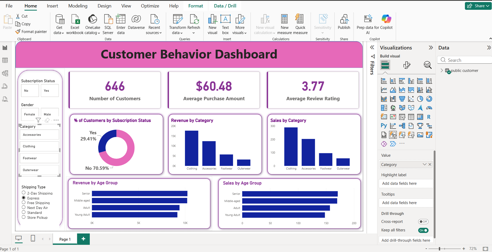

# Customer Behavior Analysis (Python, MySQL, Power BI)

## Overview
This project analyzes customer shopping behavior to understand spending patterns, subscriptions, discounts, and product performance. The data was cleaned in Python, explored with SQL in MySQL, and presented in an interactive Power BI dashboard.

**Dataset:** 3,900 customer records (`customer_shopping_behavior.csv`)

## Tools Used
- Python (pandas), Jupyter Notebook
- MySQL
- Power BI

## Dashboard

The dashboard includes KPIs (number of customers, average purchase amount, average review rating), slicers (subscription status, gender, category, shipping type), and charts for revenue and sales by category and age group.

## Workflow

### 1. Data Cleaning (Python)
- Checked the dataset with `info()`, `describe()` and `isnull().sum()`
- Filled missing Review Ratings with the median rating of each product category
- Renamed columns to snake_case for readability
- Created a new `age_group` column using quartiles (Young Adult, Adult, Middle-aged, Senior)
- Created `purchase_frequency_days` from the purchase frequency text
- Dropped `promo_code_used` because it duplicated `discount_applied`
- Loaded the cleaned data into MySQL

### 2. Exploratory Analysis (SQL)
Answered 10 business questions on:
- Revenue by gender and by age group
- Discount use and high-spending customers
- Top-rated products and top products per category
- Average purchase by shipping type
- Subscriber vs non-subscriber spending
- Products with the highest discount rate
- Customer segments (New, Returning, Loyal)
- Repeat buyers and subscriptions

### 3. Visualization (Power BI)
Built an interactive dashboard to explore revenue and sales by category, age group, subscription status, and shipping type.

## Key Findings
- **Revenue by gender:** Male customers generated $157,890 (about 68%) of the $233,081 total revenue, compared with $75,191 (about 32%) from female customers.
- **Subscriptions don't increase spending:** Subscribers spend about the same per purchase ($59.49) as non-subscribers ($59.87). Subscribers are 27% of customers (1,053 of 3,900).
- **Repeat buyers are not more likely to subscribe:** Only about 28% of customers with more than 5 previous purchases are subscribers (958 of 3,476), close to the overall rate.
- **Loyal customers dominate:** About 80% of customers (3,116) are Loyal, 18% (701) are Returning, and only 2% (83) are New.
- **Shipping:** Express shipping has a slightly higher average purchase ($60.48) than Standard ($58.46).
- **Discounts:** Hats (50%), Sneakers (49.7%), Coats (49.1%), Sweaters (48.2%) and Pants (47.4%) have the highest share of discounted purchases.
- **Top-rated products:** Gloves (3.86), Sandals (3.84) and Boots (3.82) lead, but ratings across the top 5 are close (3.78 to 3.86).
- **Age groups:** Revenue is fairly even. Young Adults contribute the most ($62,143) and Seniors the least ($55,763).
- **Best sellers:** Jewelry (Accessories), Blouse and Pants (Clothing), and Sandals (Footwear) lead their categories.

## Recommendations
- Subscriptions do not increase spend per purchase, so review the subscription benefits to give customers a reason to spend more.
- Only 2% of customers are new, so put more marketing effort into acquiring new customers.
- Some products are discounted in about half of their purchases. Test whether these discounts are needed.

## Project Structure
- `Customer_Behavior_dataset.csv`  dataset
- `Customer_Behavior_analysis.ipynb` Python cleaning notebook
- `Customer_behavior_EDA.sql` SQL queries
- `customer_behavior_dashboard.pbix` Power BI file
- `Dashboard.png` dashboard  result screenshots

## Author
**Mohamed Hasith M** | [LinkedIn](https://www.linkedin.com/in/mohamed-hasith-406801443/) | [GitHub](https://github.com/Mohamed-Hasith)
